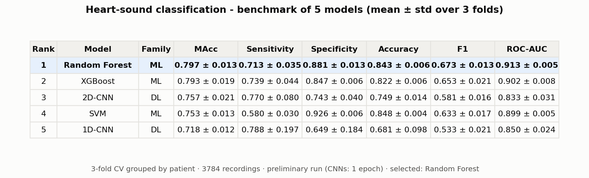
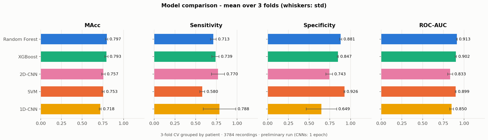
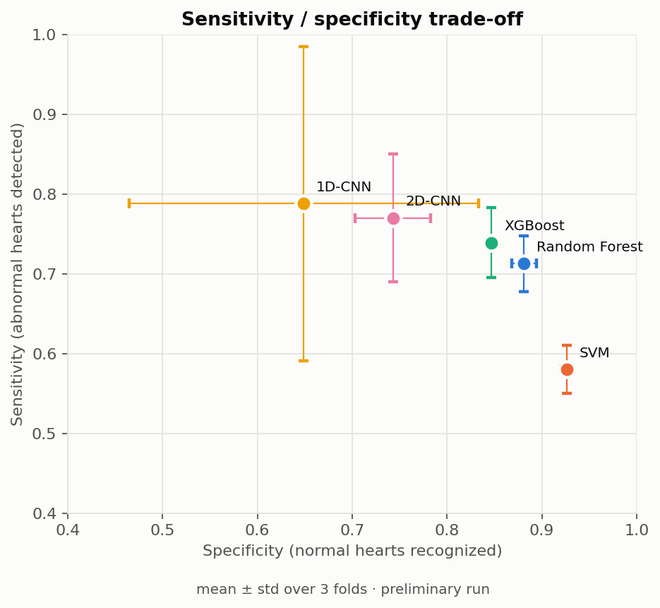
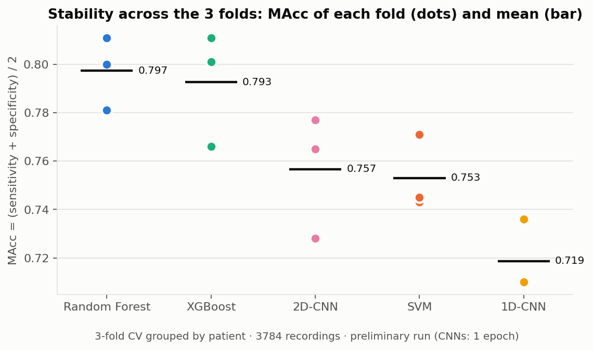

# Heart-sound classification - model benchmark (preliminary run)

Run of 2026-10-22 on `ourdataset` with `audio-engine/train.py`, logged to MLflow
(experiment `heart-sound-classification`, run `comparison`).
**Preliminary:** the 2 CNNs were trained for 1 epoch only (`--epochs 1`, quick
validation run). The full run (20 / 30 epochs) and the figures
(confusion matrices, ROC curves, training curves) will be produced by
`python benchmark/generate_report.py` after `python train.py ... --promote`.

## Protocol

- **Data:** 3784 PCG recordings (2926 normal, 858 abnormal = 23%), 3490 patients.
- **Preprocessing:** resampled to 2000 Hz, normalized, cut/padded to 5 s, 13 MFCCs.
- **Evaluation:** 3-fold cross-validation grouped by patient
  (each fold: ~66% train / ~34% test, a patient is never in both).
- **Selection metric:** MAcc = (sensitivity + specificity) / 2, the PhysioNet/CinC
  2016 score. Accuracy is misleading here: always answering "normal" already scores ~77%.

| Model | Family | Input |
|---|---|---|
| Random Forest, SVM, XGBoost | ML | 26 features: mean + std of the 13 MFCCs |
| 1D-CNN | DL | raw signal (10 000 samples) |
| 2D-CNN | DL | MFCC matrix (13 × 20) |

## Results (mean ± std over the 3 folds)









| Rank | Model | Family | MAcc | Sensitivity | Specificity | Accuracy | F1 | ROC-AUC |
|---|---|---|---|---|---|---|---|---|
| 1 | **Random Forest** | ML | **0.797 ± 0.013** | 0.713 ± 0.035 | 0.881 ± 0.013 | 0.843 ± 0.006 | 0.673 ± 0.013 | 0.913 ± 0.005 |
| 2 | XGBoost | ML | 0.793 ± 0.019 | 0.739 ± 0.044 | 0.847 ± 0.006 | 0.822 ± 0.006 | 0.653 ± 0.021 | 0.902 ± 0.008 |
| 3 | 2D-CNN | DL | 0.757 ± 0.021 | 0.770 ± 0.080 | 0.743 ± 0.040 | 0.749 ± 0.014 | 0.581 ± 0.016 | 0.833 ± 0.031 |
| 4 | SVM | ML | 0.753 ± 0.013 | 0.580 ± 0.030 | 0.926 ± 0.006 | 0.848 ± 0.004 | 0.633 ± 0.017 | 0.899 ± 0.005 |
| 5 | 1D-CNN | DL | 0.718 ± 0.012 | 0.788 ± 0.197 | 0.649 ± 0.184 | 0.681 ± 0.098 | 0.533 ± 0.021 | 0.850 ± 0.024 |

### MAcc per fold

| Model | Fold 1 | Fold 2 | Fold 3 |
|---|---|---|---|
| Random Forest | 0.800 | 0.781 | 0.811 |
| XGBoost | 0.811 | 0.766 | 0.801 |
| 2D-CNN | 0.777 | 0.765 | 0.728 |
| SVM | 0.771 | 0.743 | 0.745 |
| 1D-CNN | 0.736 | 0.710 | 0.710 |

## Model selection

**Best model: Random Forest** (MAcc 0.797), retrained on the whole dataset and
registered in the MLflow model registry as `heart-sound-classifier` version 1,
alias `production`. The audio-engine serves it: `test.wav` → `normal`
(probability of abnormal 0.22).

## Reading

- The ML models on MFCC statistics are the strongest and the most stable
  (std ≤ 0.02). Random Forest and XGBoost are nearly tied.
- SVM has the best specificity (0.93) but misses 42% of abnormal hearts
  (sensitivity 0.58): bad for screening.
- The CNNs have the best sensitivity but are under-trained here (1 epoch);
  the 1D-CNN is unstable across folds (sensitivity std 0.20).
  Next step: full training (20-30 epochs) to compare them fairly.

## Reproduce

```bash
cd audio-engine
python train.py ../ourdataset/ourdataset/train --promote   # trains the 5 models, logs to MLflow
python benchmark/generate_report.py                        # tables + figures in benchmark/results/
```
